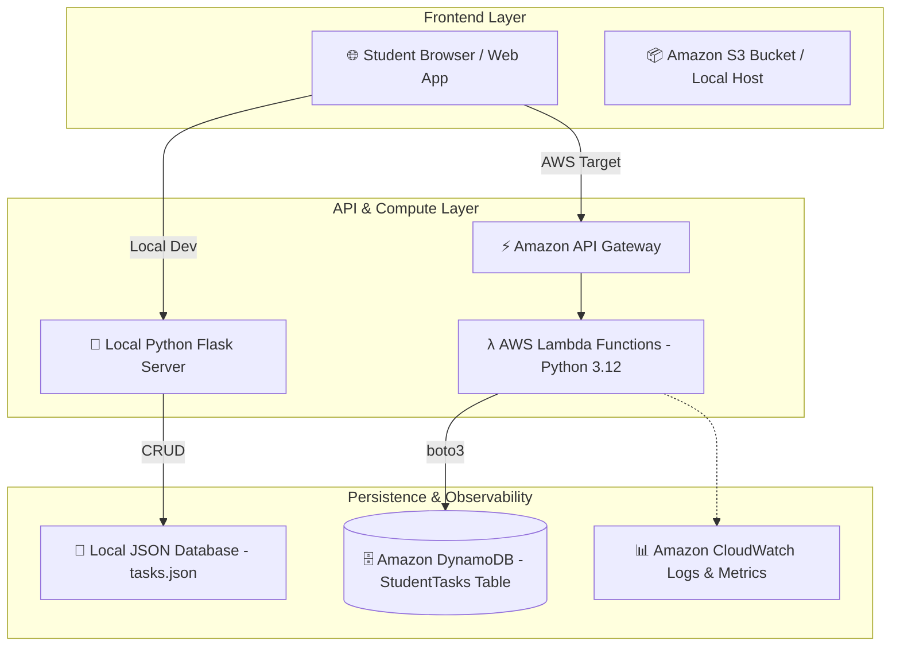
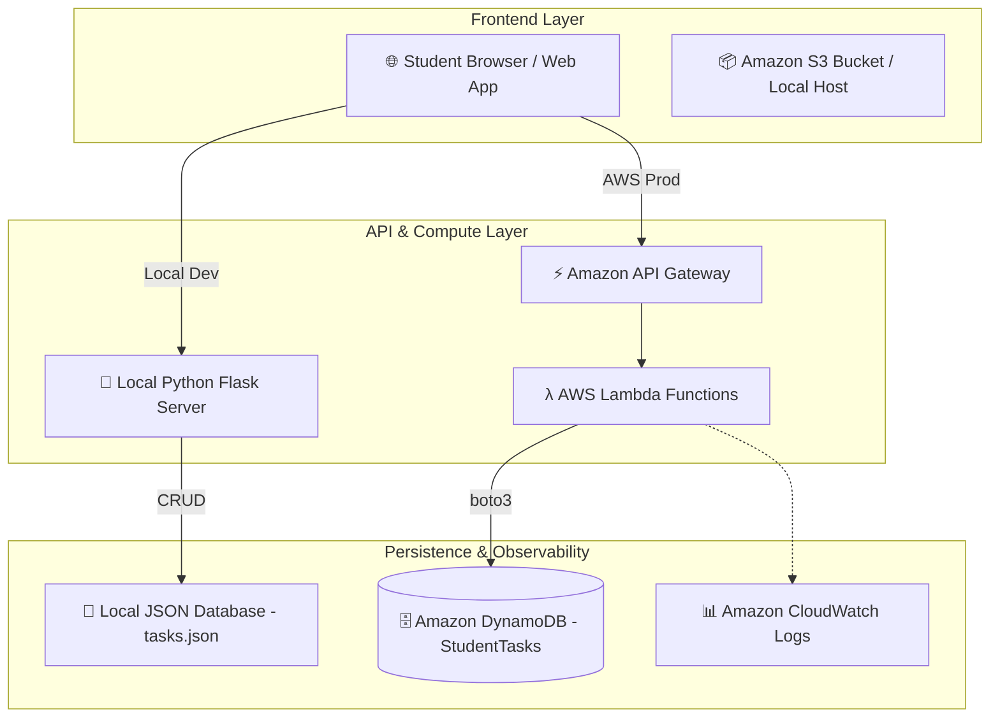

# AWS Serverless Student Task Manager

A full-stack, cloud-ready student task management application built with a modern responsive frontend, a Python Flask REST API backend, and an abstract persistence layer designed for deployment to **AWS Serverless Infrastructure** (Amazon S3, Amazon API Gateway, AWS Lambda, Amazon DynamoDB, and Amazon CloudWatch).

---

## 📌 Project & Deployment Status


> **Note on AWS Deployment:** AWS deployment is currently pending because the AWS account is temporarily unavailable. The application architecture is 100% prepared for AWS Cloud deployment and can be fully tested locally using both the Flask development server and the in-memory AWS Lambda & DynamoDB test suite.

---

## 🏛️ System Architecture




The **AWS Serverless Student Task Manager** empowers students to track assignments, exams, and projects with priority tagging, due date tracking, real-time search, interactive filter controls, and dynamic analytical statistics.

```
aws-serverless-task-manager/
├── frontend/             # HTML5, CSS3, Vanilla JS Dashboard
│   ├── index.html        # UI Layout & Modals
│   ├── style.css         # Custom Glassmorphism Design System
│   └── script.js         # API Client & State Controller
├── backend/              # Local Python Flask REST API
│   ├── app.py            # Flask Server & Routes
│   ├── database.py       # JSON File & DynamoDB Abstraction Layer
│   ├── requirements.txt  # Python Dependencies
│   └── data/
│       └── tasks.json    # Local Persistence File
├── aws/                  # Production AWS Lambda Code & Guide
│   ├── lambda/           # Serverless Handler Functions
│   │   ├── create_task.py
│   │   ├── get_tasks.py
│   │   ├── update_task.py
│   │   └── delete_task.py
│   └── README.md         # Complete AWS Deployment Guide
├── .gitignore
└── README.md
```

---

## 🏛️ System Architecture



---

## ✨ Key Features

- 📝 **Task Management (CRUD)**: Create, View, Edit, Complete, and Delete tasks seamlessly.
- 🎯 **Priority & Category Tagging**: Categorize by High/Medium/Low priority and Study/Assignment/Exam/Project/Personal tags.
- ⏰ **Smart Due Date Tracking**: Visual urgency indicators for tasks due today or overdue.
- 📊 **Analytical Dashboard**: Live counters for total, pending, completed, and high-priority tasks with a completion progress bar.
- 🔍 **Real-Time Search & Filtering**: Instant filter by status (All / Pending / Completed), priority, or search query.
- 🌙 **Modern Glassmorphic UI**: Ultra-clean responsive design system supporting Dark & Light theme modes.
- ☁️ **AWS Serverless Ready**: Decoupled database architecture with standalone AWS Lambda handlers ready for deployment.

---

## 🛠️ Technology Stack

| Component | Local Development | AWS Cloud Production |
|---|---|---|
| **Frontend** | HTML5, Vanilla CSS3, JavaScript ES6+ | Amazon S3 (Static Website Hosting) |
| **API Gateway** | Flask HTTP Router | Amazon API Gateway (REST API) |
| **Compute** | Python 3.12 (Flask) | AWS Lambda (Python 3.12 Runtime) |
| **Database** | Thread-safe File Persistence (`tasks.json`) | Amazon DynamoDB (`StudentTasks` Table) |
| **Monitoring** | Console Logging & Health Endpoints | Amazon CloudWatch Logs & Metrics |

---

## 📡 REST API Endpoints

| Method | Endpoint | Description | Request Body | Response |
|---|---|---|---|---|
| `GET` | `/api/tasks` | Get all tasks (supports `status`, `search`, `priority`) | None | `{ success, count, data, stats }` |
| `POST` | `/api/tasks` | Create a new task | `{ title, description, priority, due_date, category }` | `{ success, message, data }` |
| `PUT` | `/api/tasks/<id>` | Update task details or toggle complete | `{ title, description, priority, due_date, category, completed }` | `{ success, message, data }` |
| `DELETE` | `/api/tasks/<id>` | Delete a task by ID | None | `{ success, message, deleted_id }` |
| `GET` | `/api/stats` | Get dashboard task statistics | None | `{ success, data }` |
| `GET` | `/api/health` | API health check | None | `{ status, service, database }` |
| `POST` | `/api/seed` | Reset default sample data | None | `{ success, message, data }` |

---

## 🚀 Local Quick Start Guide

### Prerequisites
- Python 3.8+ installed on your system.

### 1. Clone & Navigate to Project
```bash
git clone https://github.com/your-username/aws-serverless-task-manager.git
cd aws-serverless-task-manager
```

### 2. Install Dependencies
```bash
pip install -r backend/requirements.txt
```

### 3. Run the Backend API Server
```bash
python backend/app.py
```

### 4. Access the Application
Open your browser and navigate to:
- 🌐 **Web Interface**: [http://localhost:5000](http://localhost:5000)
- ⚡ **API Health Check**: [http://localhost:5000/api/health](http://localhost:5000/api/health)
- 📋 **REST API Tasks**: [http://localhost:5000/api/tasks](http://localhost:5000/api/tasks)

### 5. Run Local AWS Lambda & DynamoDB Test Suite
You can execute the exact AWS Lambda handler functions (`create_task`, `get_tasks`, `update_task`, `delete_task`) locally using `boto3` and an in-memory DynamoDB mock (`moto`):
```bash
python aws/test_lambda_locally.py
```

---


## ☁️ AWS Cloud Deployment Roadmap

For complete instructions on deploying this application to AWS, refer to the [AWS Deployment Guide](aws/README.md).

Summary of AWS services used:
1. **Amazon S3**: Hosts the static web frontend.
2. **Amazon API Gateway**: Routes REST API HTTP requests to Lambda functions.
3. **AWS Lambda**: Serverless Python execution environment handling business logic.
4. **Amazon DynamoDB**: NoSQL cloud database storing task records.
5. **AWS IAM**: Manages security policies between Lambda and DynamoDB.
6. **Amazon CloudWatch**: Monitors API traffic, logs, and error rates.

---

## 📜 License

Distributed under the MIT License. See `LICENSE` for more information.
